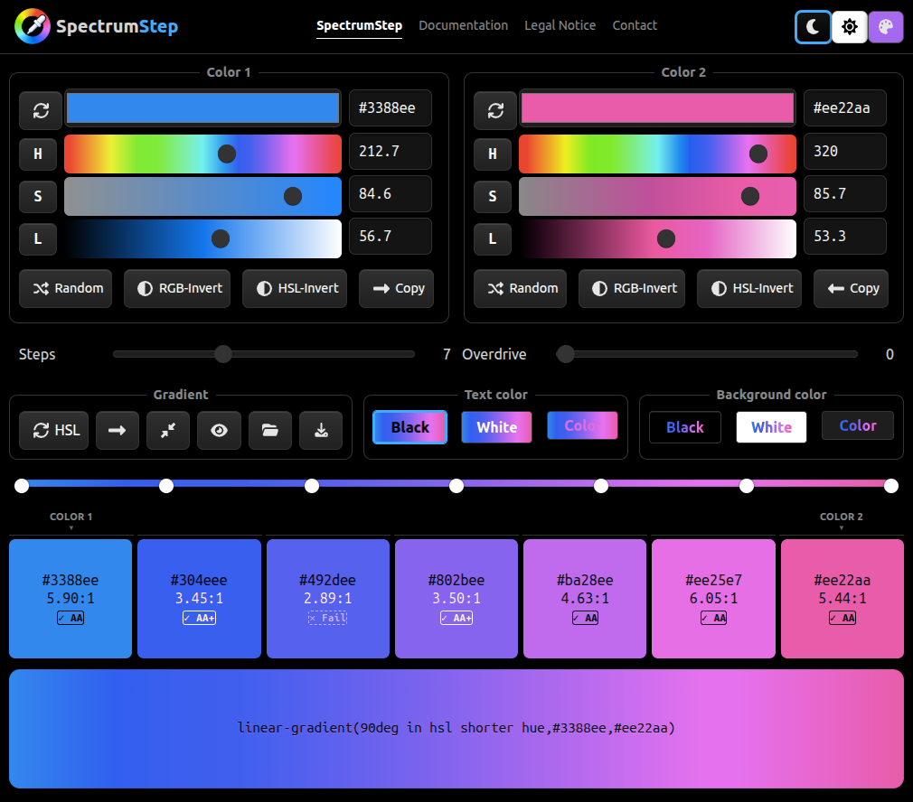

# SpectrumStep

**SpectrumStep** is a multi-space gradient, color mixer, and palette generator with real-time WCAG 2.1 contrast evaluation. It allows you to create discrete color palettes and continuous CSS gradients across cylindrical (**HSL, HSV, Oklch**), additive (**sRGB**), and perceptual Cartesian (**Oklab**) color spaces.

Key features include interactive multi-position swatch sliders, 2D color plane pickers for any channel component, overdrive extrapolation with automatic duplicate pruning, chroma-reduction gamut mapping for out-of-gamut Oklab/Oklch colors, real-time WCAG AA/AAA contrast auditing, and ready-to-use CSS Color 4 `linear-gradient` export.

## Development

Available scripts:

- `npm start` — serve the project locally at `http://127.0.0.1:3000` using Python 3.
- `npm run build` — create a deployable `dist/` folder containing the app, documentation, styles, scripts, and assets.

## features
- besides HSL, use RGB, HSV, Oklab, and Oklch mixing and input spaces
- gamut mapping via chroma reduction when converting out-of-gamut Oklab/Oklch colors to sRGB HEX
- native CSS Color 4 linear-gradient interpolation (`in oklab`, `in oklch shorter|longer hue`, `in hsl shorter|longer hue`)
- interactive multi-pos gradient slider: thin colored bar with draggable circle knobs (same size and color as range slider thumbs) for each swatch, slidable across the full extent (0%–100%) with overtaking, real-time percentage tooltip, and live swatch color interpolation
- overdrive extrapolation with automatic pruning of duplicate saturated/clamped points
- dedicated indicator line under the gradient swatches with small monochromatic Color 1 & Color 2 markers, indicating the gradient belonging to the corner colors for instant recognition and easy HEX export
- C2 to C1 copy color and vice versa
- store in details to hide if unused
- header back-color controls for pure black, pure white, or a custom color; the UI automatically chooses a contrasting light or dark theme
- custom back color can be selected with the color picker or taken from Color 1 / Color 2, and is retained in the current session, shareable URL, named localStorage presets, and JSON export/import
- random color button
- RGB text input
  - expands 3-digit hex colors
  - **onkey event:** At each key, it check for valid color, then update color and gradient. If  value is invalid then don't display color (keep the last), warn with tooltip, "invalid entry". also when user leaves input with a invalid color, f.e.  5 digits instead of 6
- component value formats for designers and developers: click the border of a component input to cycle its format
  - HSL / HSV: `360° / 100% / 100%`, `360° / 0–1 / 0–1`, `0–1 / 0–1 / 0–1`; RGB: `0–255`, 2-digit hex `00–ff`, `0–1`; Oklab / Oklch: `l` in `%` or `0–1`
  - a ring segment on the 3 inputs shows the active format (same design as the switch buttons); it is remembered per color and per color space
  - cycling formats never changes the color: the exact value is kept, also behind a rounded hex or 0–255 display
  - hex input accepts upper- and lowercase, a single digit means a leading zero (`8` → `08`)
  - all values always show all decimals with trailing zeros and are right-aligned, so the decimal points line up
  - spin buttons and arrow keys step on the last displayed digit of the active format
  - erroneous entries (invalid hex digits, not a number, too high / too low) stay as typed, get a red border and a tooltip naming the problem; the color keeps its last valid value
  - stored compactly in the URL search param `im`, in named presets and in JSON export/import
- gradientDirection in all 4 direction
- enhanced accuracy for HSV, HSL, Oklab, and Oklch modes, no loss of RGB value
- each color in gradient holds contrast info including WCAG AA / AAA badges (Pass/Fail)
  - contrast info and the gradient rating always be visible
  - contrast info can be disabled
- copy function with visual feedback at gradient swatches & CSS linear gradient
- gradient options popup (gear button): gap, border-radius, font size / weight / style / family, text decoration, horizontal and vertical text alignment and custom swatch text, all with live update; stored in share links (`so`, `sx`), presets and JSON
- swatch popup (click a swatch): copy as HEX, HEX+alpha, RGB, RGBA, HSL, HSLA, HSV, HWB, OKLCH, OKLab, Lab, LCH or CSS variable `--spectrum-N`; export as HTML (inline CSS or `<style>`), CSS, SVG or PNG
- gradient popup (click the continuous gradient): copy `linear-gradient(...)`, SVG, PNG
- export button: PNG / SVG of exactly what is on screen (swatches or continuous gradient), HTML / CSS of all swatches (`.spectrumstep-container`, `.spectrumstep-swatch-N`; no contrast info)
- dragged swatch positions are used by all exports and kept in share links (`sp`), presets and JSON
- hue allows 2 gradients, longer and shorter way (HSL, HSV, Oklch)
- use tooltips to clarify exactly what utility does
- URL search params with color and gradientsetting to make share of colors easy
- use storage to retain information, when switching to docu and back
  - the links from the docs back to the app carry the search params of the last app state, so the colors are not reset (a plain `./` link starts from the defaults)
- documentation in header as link with same header with app and theme switch
- 2D color plane popup for each fixed color component (H/S/L, R/G/B, H/S/V, l/a/b, l/c/h) to pick the remaining 2 components (X/Y) with real-time gradient updates (opened via channel button or double-clicking the range slider)
- image color picker (eye dropper button in the header): drop, paste (Ctrl+V) or choose a picture, then click a pixel to set Color 1, Color 2, the text color, the back color (contrast check) or the page color
  - drop an image anywhere on the app page (a JSON file loads a palette instead); a new image replaces the loaded one
  - sample size `1 px`, `3×3` or `5×5` (average, transparent pixels skipped); loupe with the magnified pixels and the hex a click would pick
  - wheel / pinch zoom up to 32×, drag to pan, keys `+` `-` `0`; EXIF rotation is applied; touch: loupe aims above the finger, two fingers pan and zoom
  - rings with `1` `2` `T` `B` `P` mark the last pick of each target and disappear when the color is changed otherwise
  - while the popup (or the gradient options popup) is open, the header and the gradient are docked at the top and the bottom / right edge, so every pick is visible live
  - the Gradient block, Steps and Overdrive move into the popup header while it is open (they wrap on narrow screens); the popup takes the page color, also a custom back color; a click on a free spot of the header closes it
  - the image is cached in this browser (IndexedDB `spectrumstep-image`) and survives reloads and the way to Docs and back; it is never part of JSON export, presets, session state or URL

## UI
- icon: make icons light in dark theme
- icon: every button has icon
- split Color1 and Color2 to 2 equal inputs, flex-wrap horizontally
- Steps & Overdrive without text input next to each other, for mobile with flex-wrap 
- text/back-color eliminate radio buttons and use colored-empty-buttons just as color
- HSL/RGB/HSV/Oklab/Oklch-gradient eliminate radio buttons and use single-selection-buttons
- input for numbers with monospace font
- channel identifier buttons in first column (`H/S/L`, `R/G/B`, `H/S/V`, `l/a/b`, `l/c/h`) and double-clicking channel range sliders open a floating 2D color plane aligned to the range slider width without overlapping gradient swatches

## infrastructure
- no runtime dependencies; local dev server is Python's `http.server` (serves `docu/` as `docu/index.html`, so links stay clean without `index.html`)
- production: Apache on ardoid.eu; `.htaccess` (copied into `dist/` by the build) handles the https trailing-slash redirect, compression and caching
